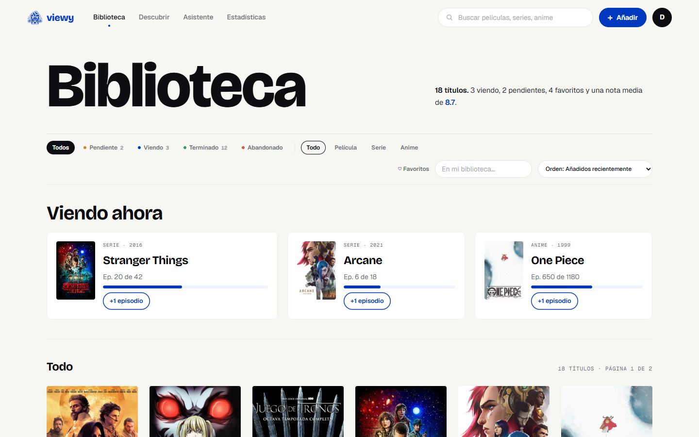
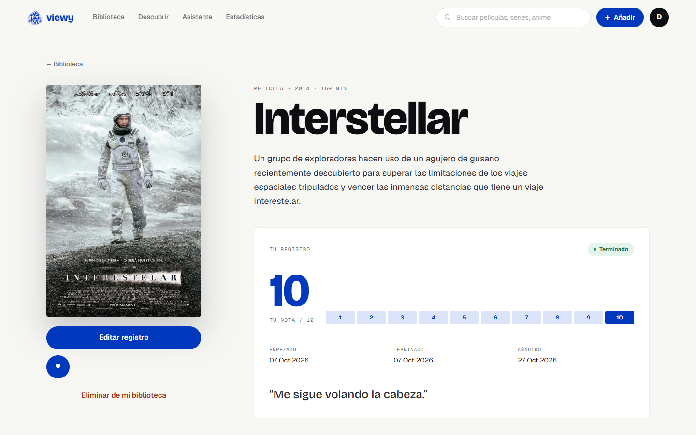
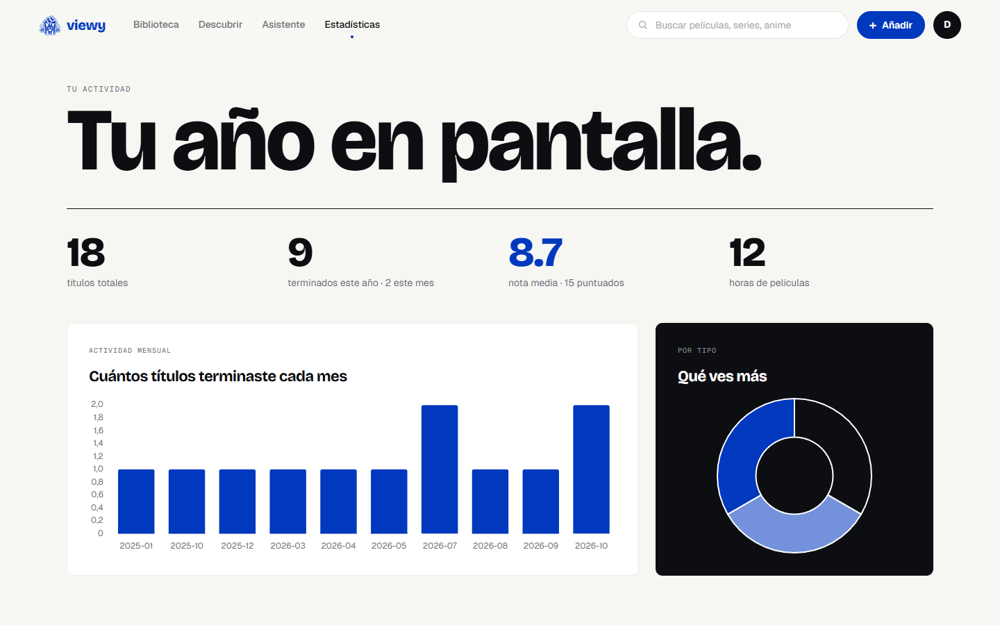
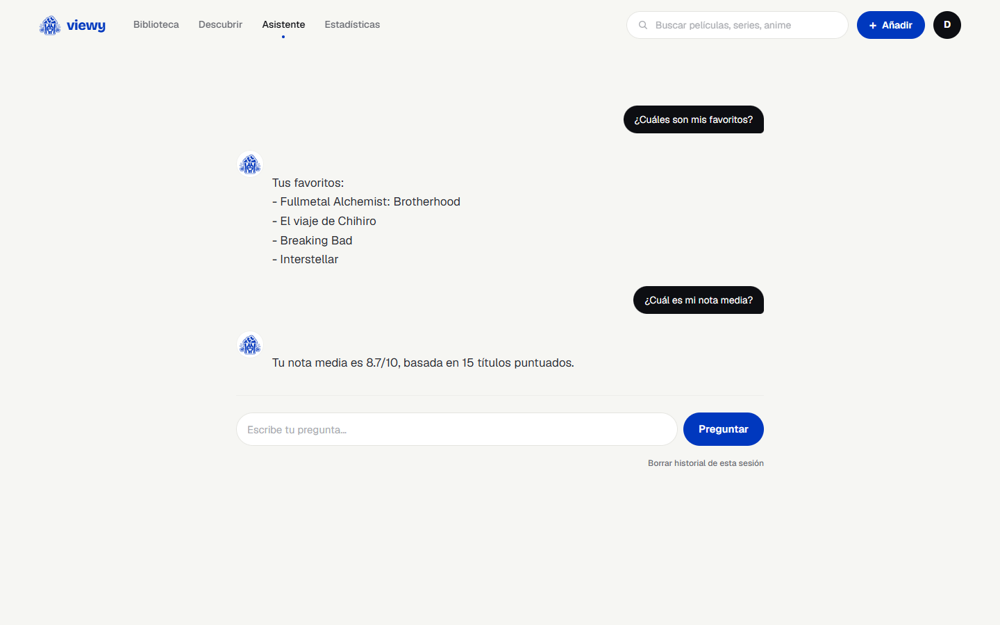
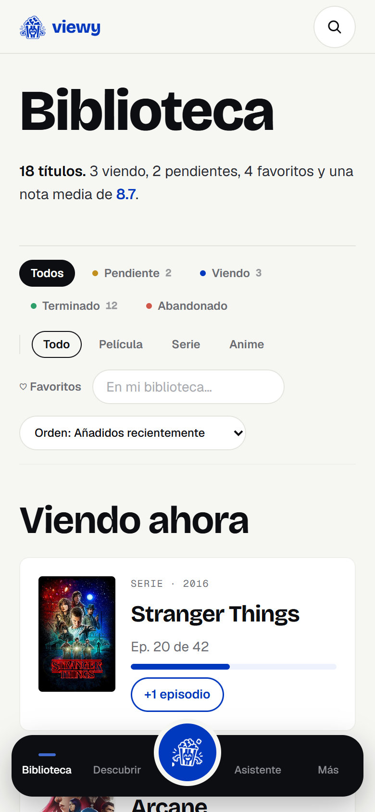
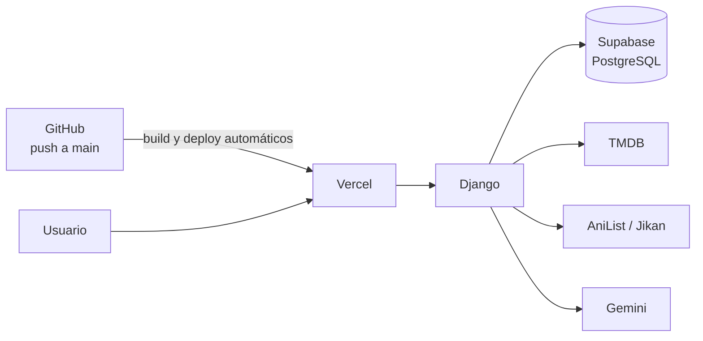
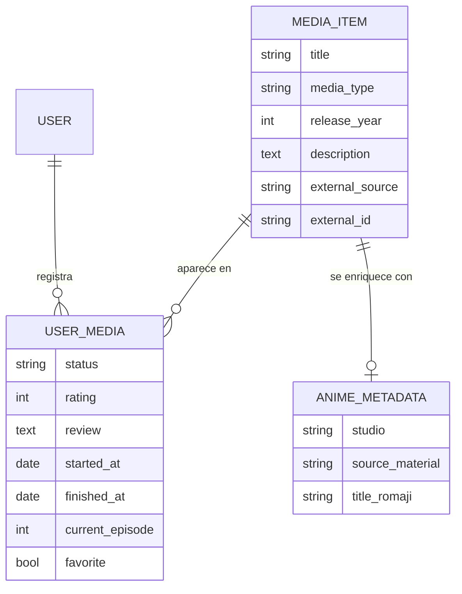

# Viewy

Tracker personal de películas, series y anime con estadísticas de tus hábitos, recomendaciones con IA y un asistente que responde preguntas sobre tu propia biblioteca.

**[Ver demo en vivo](https://viewy-tau.vercel.app)** · usuario `demo` · contraseña `viewy-demo`


## Qué es

Lo que ves acaba repartido entre notas del móvil, listas sueltas y memoria. En Viewy cada usuario registra lo que ha visto, lo que está viendo, lo que quiere ver y lo que ha abandonado, con nota, reseña, fechas y progreso de episodios. Con ese historial, la aplicación genera estadísticas y recomendaciones.

Es un proyecto personal de portfolio que cubre todo el recorrido: modelo de datos, backend, integración con APIs externas, análisis de datos, IA y despliegue en producción.

## Funcionalidades

- **Biblioteca personal**: estados (pendiente, viendo, terminado, abandonado), nota del 1 al 10, reseña, fechas de inicio y fin, episodio actual y favoritos. Incluye búsqueda, filtros, ordenación y paginación.
- **Búsqueda en TMDB**: cada resultado tiene una ficha con póster, datos y sinopsis en español antes de añadirlo.
- **Anime**: detecta qué resultados de TMDB son anime y los enriquece con AniList (estudio, material original, personajes). Si AniList falla, usa Jikan.
- **Estadísticas**: un panel con Django ORM y un análisis más avanzado con pandas (evolución mensual, notas por tipo, distribución de notas, hábitos), con gráficas de Chart.js.
- **Recomendaciones con IA**: pides algo en lenguaje natural, como *"una serie corta para el fin de semana"*, y recibes títulos basados en tu historial y comprobados en TMDB.
- **Asistente**: responde preguntas sobre tu biblioteca (*"¿qué anime terminé el año pasado?"*, *"¿dónde puedo ver Dark?"*) con datos calculados por código.
- **Importación de listas antiguas**: pegas un texto como `Breaking Bad 9`, revisas las coincidencias en una vista previa, corriges lo que haga falta y confirmas.
- **Diseño responsive**, con navegación propia para móvil.

## Capturas

| Biblioteca | Ficha de un título | Estadísticas |
|---|---|---|
|  |  |  |

| Asistente | Móvil |
|---|---|
|  |  |

## Stack

| Capa | Tecnologías |
|---|---|
| Backend | Python 3.12, Django 6, Django ORM, pandas |
| Base de datos | PostgreSQL en Supabase (producción), SQLite (local) |
| Frontend | Plantillas de Django, Tailwind CSS v4, JavaScript, Chart.js |
| APIs externas | TMDB, AniList, Jikan, Google Gemini |
| Testing | pytest, pytest-django |
| Despliegue | Vercel con despliegue continuo desde GitHub, WhiteNoise |

## Arquitectura



| App | Responsabilidad |
|---|---|
| `accounts` | Usuario personalizado, registro, login y perfil |
| `library` | Modelos de contenido, CRUD, búsqueda y filtros de la biblioteca |
| `integrations` | Clientes de TMDB, AniList, Jikan y Gemini, separados del resto de la aplicación |
| `analytics` | Estadísticas: Django ORM en `services.py` y pandas en `dataframes.py` |
| `recommendations` | Perfil de gustos, consulta al LLM y verificación en TMDB |
| `assistant` | Preguntas sobre la biblioteca: el LLM interpreta y Python calcula |
| `imports` | Importación de listas en texto con vista previa y confirmación |

Las views solo gestionan la petición y la respuesta. La lógica de negocio está en el `services.py` de cada app y las llamadas a servicios externos están en `integrations/`.

## Modelo de datos



Se separa **el contenido** (`MediaItem`) de **la relación de cada usuario con ese contenido** (`UserMedia`). Una película existe una sola vez aunque la tengan cien usuarios, y cada uno guarda en `UserMedia` su estado, su nota y su reseña.

La integridad se garantiza en la base de datos, no solo en los formularios:

- Un usuario no puede tener el mismo título dos veces.
- No puede haber dos `MediaItem` con el mismo identificador externo.
- La nota tiene que estar entre 1 y 10.
- El año de estreno tiene que ser razonable.

## Decisiones técnicas

**El LLM no calcula.** En el asistente, Gemini solo clasifica la pregunta en un *intent* de una lista cerrada y extrae filtros como tipo, estado, año o mes. Lo hace con una respuesta JSON validada antes de usarla. El cálculo lo hacen Python, el ORM y pandas, y la respuesta se redacta con plantillas. Así los números siempre salen de la base de datos, y una respuesta mal formada del modelo no rompe nada.

**Recomendaciones con contexto mínimo y verificadas.** El LLM no recibe la biblioteca entera, solo un perfil agregado: tipos favoritos, títulos mejor puntuados, abandonados y duración media. Cada título que propone se comprueba en TMDB, y se descartan los que no existen o ya están en tu biblioteca.

**ORM o pandas según el cálculo.** Los conteos, medias y agrupaciones simples se hacen con el ORM, que los resuelve en SQL. Las series temporales, distribuciones y comparaciones entre grupos se hacen con pandas sobre un DataFrame de la biblioteca del usuario. Cada tipo de cálculo está en su propio módulo, para que se vea qué herramienta calcula cada dato.

**Integraciones aisladas y tolerantes a fallos.** Cada API tiene su cliente en `integrations/`, con timeouts y excepciones propias. Si TMDB no responde, el usuario ve un mensaje en lugar de un error 500. Para anime se consulta primero AniList y, si falla, Jikan.

**Sinopsis en español con respaldo.** TMDB se consulta en `es-ES`. Si un título no tiene sinopsis traducida, se guarda la inglesa y la interfaz avisa de ello.

**Aislamiento entre usuarios.** Todas las consultas de la biblioteca filtran por el usuario autenticado. Si alguien pide el registro de otro usuario, recibe un 404 y no ve sus datos. Hay tests específicos que lo comprueban.

## Uso de pandas

[`analytics/dataframes.py`](analytics/dataframes.py) construye un DataFrame con la biblioteca del usuario y calcula:

- títulos terminados por mes
- nota media por tipo de contenido
- distribución de notas
- actividad por año
- mes con más títulos terminados
- evolución del tipo de contenido a lo largo del tiempo
- hábitos de puntuación

## Integración con IA

Se usa Gemini (`gemini-2.5-flash`) en tres funciones. Siempre devuelve una respuesta estructurada con un esquema JSON y solo recibe el contexto imprescindible:

- **Asistente**: interpreta la pregunta del usuario.
- **Recomendaciones**: elige títulos a partir del perfil de gustos.
- **Importación**: resuelve en bloque las líneas ambiguas, y solo cuando hace falta.

La clave de la API nunca está en el código: se lee de una variable de entorno.

## Tests

```bash
pytest
```

Hay más de 250 tests que cubren:

- modelos y constraints
- autenticación y permisos entre usuarios
- CRUD y formularios
- servicios, analytics, asistente, recomendaciones e importación

Ningún test llama a una API real: TMDB, AniList, Jikan y Gemini están mockeados.

## Instalación local

Requisitos: Python 3.12 o superior y Node.js (para compilar Tailwind).

```bash
git clone https://github.com/israelrfp03/viewy.git
cd viewy

python -m venv .venv
.venv\Scripts\activate          # Windows · en macOS/Linux: source .venv/bin/activate
pip install -r requirements-dev.txt

npm install
npm run build:css               # o npm run watch:css mientras desarrollas

cp .env.example .env            # y rellena las variables
python manage.py migrate
python manage.py runserver
```

Para tener datos de ejemplo:

```bash
python manage.py seed_demo --password la-que-quieras
```

Este comando crea el usuario `demo` con una biblioteca de 18 títulos reales de TMDB. Si lo vuelves a ejecutar, la biblioteca vuelve a su estado inicial.

## Variables de entorno

| Variable | Uso |
|---|---|
| `SECRET_KEY` | Clave secreta de Django |
| `DEBUG` | `True` en local y `False` en producción |
| `DJANGO_ALLOWED_HOSTS` | Dominios permitidos, separados por comas |
| `TMDB_ACCESS_TOKEN` | Token de lectura de la API de TMDB |
| `GEMINI_API_KEY` | Clave de Google AI Studio |
| `DATABASE_URL` | Solo en producción: connection string de Supabase. Si no está definida, se usa SQLite |
| `CSRF_TRUSTED_ORIGINS` | Solo en producción: dominio público con `https://` |

Hay una plantilla en [`.env.example`](.env.example). Ni el archivo `.env` ni ningún secreto se suben al repositorio.

## Despliegue

**GitHub → Vercel → Django → Supabase**

- Cada push a `main` despliega automáticamente en Vercel. El build ([`build_files.sh`](build_files.sh)) compila Tailwind, instala las dependencias y ejecuta `collectstatic`.
- Los archivos estáticos los sirve WhiteNoise, comprimidos y con hash en el nombre para aprovechar la caché.
- Supabase se usa solo como PostgreSQL gestionado. La autenticación es la de Django.
- En producción la app se conecta a Supabase a través del *transaction pooler* (puerto 6543), adecuado para un entorno serverless.
- Las migraciones se aplican a mano, a través del *session pooler* (puerto 5432), antes del push que las necesita. Así el código nuevo nunca se despliega antes que su esquema.
- En producción se usan `DEBUG=False`, cookies seguras, HSTS y cabeceras de proxy para HTTPS.

## Limitaciones

- **Planes gratuitos.** Supabase pausa el proyecto tras una semana sin actividad, así que la primera visita puede fallar hasta que se reactive. Gemini tiene una cuota diaria: si se agota, el asistente y las recomendaciones muestran un mensaje de error controlado.
- **La cuenta demo es compartida.** Cualquiera puede modificar su biblioteca. Se restablece con `seed_demo`.
- **Sin géneros.** Los géneros todavía no se importan de TMDB, así que las estadísticas por género no están disponibles.

## Cómo se ha construido

El proyecto se ha desarrollado por fases, desde la configuración inicial hasta el despliegue, siguiendo el roadmap de [`CLAUDE.md`](CLAUDE.md). He usado Claude Code como asistente de programación: me ha propuesto implementaciones y alternativas, y yo he elegido entre ellas, he revisado y probado cada fase antes de pasar a la siguiente y he hecho el despliegue en Vercel y Supabase.

El diseño visual parte de un handoff de diseño ([`design_handoff_viewy_redesign/`](design_handoff_viewy_redesign/)) que he adaptado a las plantillas de Django con Tailwind CSS.

## Autor

Israel Rivera · [GitHub](https://github.com/israelrfp03)
